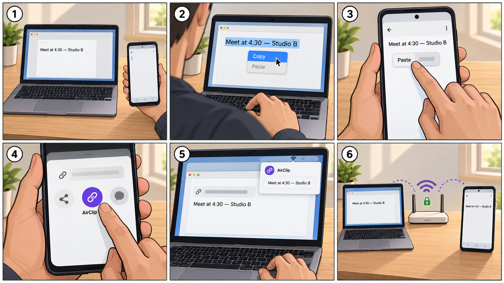

# Airclip case-study video

## The idea

Make one 40-second video about one promise:

> Move a clip between a Mac and Android without messaging yourself.

Show the result before setup. Keep the transfer in real time so viewers can feel how fast it is.

## Prepare before filming

- Put the Mac and Android on the same Wi-Fi and pair them before recording.
- Turn on Do Not Disturb on all three devices.
- Clean the camera lens and both screens.
- Set the recording phone to landscape, 1080p, 30 fps. Use the rear camera.
- Rest the camera on a tripod or a stack of books. Do not hold it.
- Use one sample text: `Meet at 4:30 — Studio B`.
- Have one harmless web link ready on Android for the return trip.
- Open a blank note on both devices and set screen brightness around 70%.
- Record each shot for two seconds before and after the action. This makes editing easier.

## 40-second shot list and script

| Time | What to film | Voice-over | On-screen text |
| --- | --- | --- | --- |
| 0–3s | Wide shot: Mac and Android together. Hold the phone beside the Mac. | “My Mac and Android never shared a clipboard.” | **Mac + Android. One clipboard.** |
| 3–9s | Close shot of the Mac. Select `Meet at 4:30 — Studio B` and press Copy. Keep the phone visible at the edge of frame. | “With Airclip, I copy normally on my Mac…” | **Copy on Mac** |
| 9–14s | Close shot of Android Notes. Long-press and tap Paste. Let the pasted text stay visible for one full second. | “…and paste it on Android.” | **Paste on Android** |
| 14–17s | Brief shot of Airclip history showing the clip and its source device. | “It arrives in under two seconds…” | **Under 2 seconds** |
| 17–25s | On Android, share a harmless link, choose Airclip in the Share menu, and hold for one beat. | “Going back, Android uses Share, then Airclip.” | **Share → Airclip** |
| 25–31s | On the Mac, paste the received link into a note. | “Now it is ready on my Mac.” | **Paste on Mac** |
| 31–35s | Optional quick insert: Mac pairing QR with Android camera aimed at it. Do not film the whole setup. | “Pair once. No account.” | **Pair once** |
| 35–42s | Return to the clean wide shot. Both devices show the shared content. | “Clips move directly over my local Wi-Fi—encrypted, with no cloud clipboard.” | **Same Wi-Fi · No account · No cloud clipboard** |

## Record the voice-over

Record the video first. Then read this slowly in a quiet room:

> My Mac and Android never shared a clipboard. With Airclip, I copy normally on my Mac and paste it on Android. It arrives in under two seconds. Going back, Android uses Share, then Airclip. Now it is ready on my Mac. Pair once, with no account. Clips move directly over my local Wi-Fi—encrypted, with no cloud clipboard.

## Keep the edit basic

- Use straight cuts only. No transitions or zoom effects.
- Speed up only hand movement or waiting before an action. Never speed up the actual transfer.
- Add large captions near the bottom, but keep them away from the devices.
- Keep device-tap sounds quiet under the voice-over.
- Skip music for the first version. Clear narration matters more.
- End on the final frame for two seconds.

## Do not put in this video

Do not tour Settings, every clip type, filters, retention, or every security rule. Those are better as screenshots or a second video. The first video only needs to prove the two-way journey, the real Android Share step, and the local-first promise.

## Storyboard

